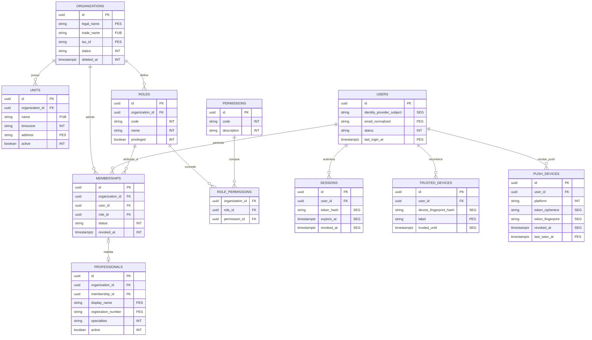
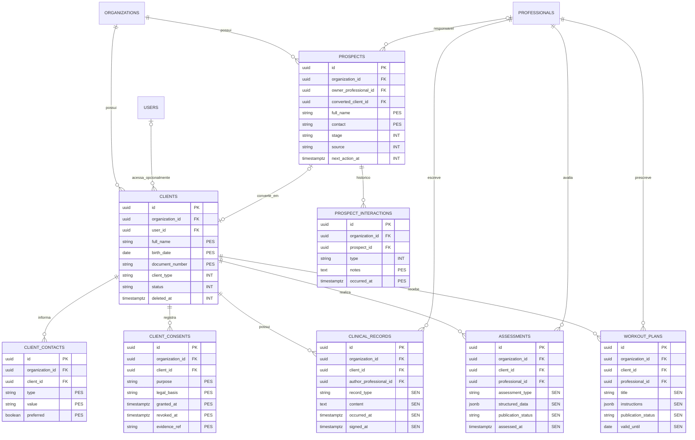
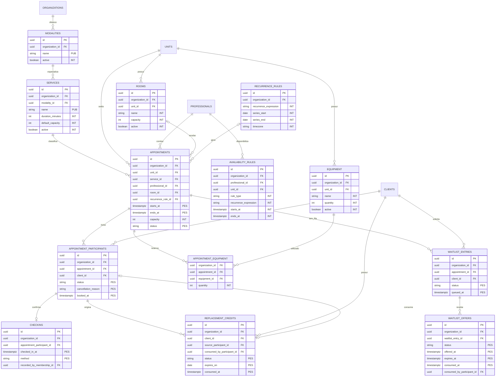
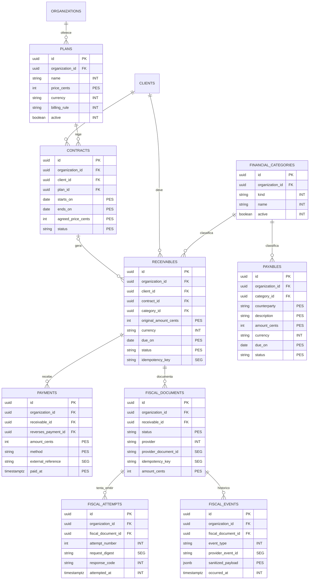
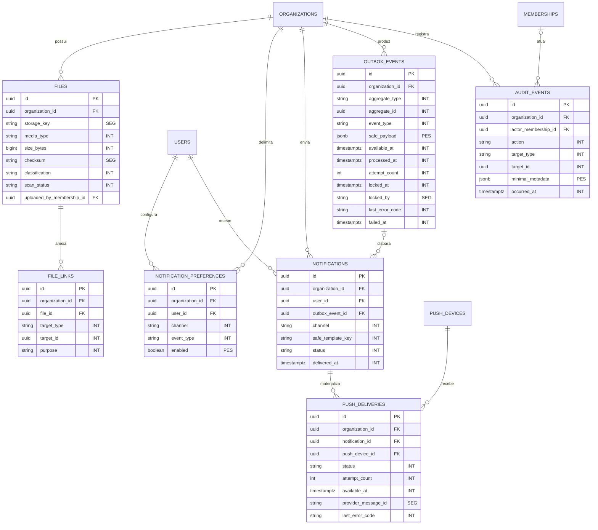

# DATA-001 — Diagrama de dados inicial

> Estado: **Concluída**. Revisão: 2026-09-01.
>
> Este é o modelo conceitual que orientará `DATA-002`. Nomes, tipos e restrições ainda serão confirmados nas migrations, sem enfraquecer as invariantes de propriedade, isolamento e histórico definidas aqui.

## 1. Legenda e invariantes

Classificação usada no documento:

| Marca | Classe | Exemplos | Regra mínima |
| --- | --- | --- | --- |
| `PUB` | Público | nome comercial, modalidades divulgadas | Pode ser publicado somente quando houver intenção explícita. |
| `INT` | Interno | capacidade, regras, identificadores técnicos | Disponível apenas a pessoas autenticadas e autorizadas. |
| `PES` | Pessoal | nome, contato, nascimento, identificadores | Acesso por necessidade, retenção definida e proibição em logs/URLs. |
| `SEN` | Pessoal sensível | prontuário, avaliação, condição de saúde, treino terapêutico | Autorização clínica separada, auditoria e proteção reforçada. |
| `SEG` | Segredo | token de sessão, token push, credencial fiscal | Nunca retorna ao cliente após cadastro; criptografia ou hash específico e rotação. |

Invariantes do modelo:

1. Todo dado de negócio contém `organization_id NOT NULL`, inclusive tabelas filhas. A coluna não é derivada de um valor enviado pelo navegador: vem do contexto autenticado e participa das políticas RLS.
2. `users`, `permissions`, `sessions`, `trusted_devices` e `push_devices` são dados de plataforma e não pertencem a uma clínica. O acesso a uma clínica sempre passa por `memberships`.
3. Chaves primárias são UUIDs. Tabelas mutáveis possuem `created_at`, `updated_at` e, quando a exclusão for permitida, `deleted_at`. Instantes usam `timestamptz`; a unidade mantém seu fuso IANA para exibição.
4. Valores monetários usam inteiros em centavos e código ISO de moeda. Pagamentos, eventos fiscais, auditoria e lançamentos consumidos não são apagados.
5. Relações entre tabelas multiempresa usam FKs compostas ou restrições equivalentes incluindo `organization_id`, para que uma FK válida não possa atravessar clínicas.
6. Dados `SEN` e `SEG` não entram em logs, analytics, URLs, notificações push ou armazenamento local. Arquivos são privados e entregues por autorização e link temporário.
7. Identidade (`users`), pessoa atendida (`clients`) e vínculo profissional (`professionals`) são conceitos diferentes. Um cliente ou profissional pode ganhar acesso ao portal por `user_id`, mas o cadastro operacional não depende disso.

## 2. Visão de propriedade

| Proprietário / escopo | Entidades | Observação |
| --- | --- | --- |
| Plataforma | `users`, `permissions`, `sessions`, `trusted_devices`, `push_devices` | Não contêm dados de negócio de uma clínica. |
| Organização | `organizations` | Raiz do tenant; apenas operações administrativas de plataforma podem atravessar tenants. |
| Organização | `units`, `roles`, `memberships`, `clients`, `professionals`, `prospects`, `services`, `modalities`, `plans`, `financial_categories` | Raízes funcionais sempre filtradas por `organization_id`. |
| Organização, por meio da raiz funcional | contatos, consentimentos, registros clínicos, avaliações, treinos, interações, contratos, agenda, fila, créditos, financeiro, fiscal e arquivos | A entidade filha repete o mesmo `organization_id` da raiz; divergência deve falhar no banco. |
| Organização e destinatário | `notifications`, `notification_preferences` | Preferências são por usuário e clínica; revogar membership encerra o acesso naquele tenant. |
| Organização, append-only | `audit_events`, `outbox_events` | Ator pode ser nulo em ações do sistema, mas clínica e alvo permanecem obrigatórios. |

## 3. Identidade, organização e autorização

Restrições principais:

- `memberships`: único vínculo ativo por `(organization_id, user_id)`; troca de papel preserva histórico auditável.
- Papéis iniciais: proprietário, administrador, profissional, recepção/financeiro e cliente. Permissões são negadas por padrão; acesso clínico não decorre automaticamente de ser administrador.
- `professionals.membership_id` é opcional e único. Assim, um profissional pode existir na agenda antes de aceitar acesso ao sistema.
- E-mail não concede acesso a uma clínica e não substitui o vínculo em `memberships`.

## 4. CRM e atendimento clínico

Regras principais:

- A conversão de prospect é idempotente: `converted_client_id` é único e mantém o histórico de origem.
- Registros assinados não são editados silenciosamente; correções criam nova versão/adendo e mantêm autoria e instante.
- `publication_status` controla o que pode aparecer no portal do cliente. Ser titular do dado não torna automaticamente toda anotação interna publicável.
- Campos clínicos definitivos e prazos de retenção dependem de `NEG-004` e validação jurídica/profissional. Até lá, migrations não devem criar coleta clínica ampla.

## 5. Agenda, recursos, presença e reposição

Restrições transacionais:

- Participante único por `(organization_id, appointment_id, client_id)` enquanto ativo; capacidade é ocupada e validada na mesma transação.
- Exclusões de intervalo impedem sobreposição do profissional e da sala. Reserva de equipamento valida quantidade disponível no intervalo.
- Uma série guarda a regra e cada ocorrência é um `appointment`; alterações pontuais não reescrevem a série inteira.
- Há no máximo uma entrada ativa por cliente/agendamento, uma oferta ativa por vaga e consumo atômico antes de `expires_at`.
- Crédito possui exatamente uma origem e, quando consumido, exatamente um participante de destino. Saldo não é um campo mutável: deriva de créditos válidos ainda não consumidos.
- Cancelamento, presença e falta são estados históricos/auditados; não removem o participante.

## 6. Financeiro, fiscal e contratos

Regras principais:

- O saldo de um recebível deriva do valor original menos pagamentos líquidos e estornos. Pagamento parcial não sobrescreve o valor original.
- Estorno é um novo `payment` com `reverses_payment_id`; lançamentos liquidados são imutáveis.
- A unicidade de `idempotency_key` é por organização e operação. Uma cobrança não pode ter duas NFS-e autorizadas equivalentes.
- Estados e políticas de cobrança estão formalizados em `FIN-001`; o modelo preserva valor original, parciais, estornos e histórico.
- Dados tributários completos, XML e PDF são `PES`/`SEN` conforme o conteúdo e ficam em arquivo privado. Credenciais e certificados fiscais são segredos de infraestrutura, não colunas destas tabelas.

## 7. Plataforma, arquivos, notificações e auditoria

Decisões de integridade e exposição:

- `file_links.target_type` é uma associação controlada. Em `DATA-002`, cada tipo permitido deve ganhar FK verificável (tabela de vínculo específica ou trigger); não será aceito um alvo arbitrário sem integridade.
- `storage_key` nunca é URL pública. Download revalida tenant, função, relação com o atendimento e, para conteúdo clínico, permissão clínica.
- `safe_template_key` impede que o push de tela bloqueada carregue nome, condição clínica, valor ou conteúdo fiscal. O detalhe só é obtido depois da autenticação.
- `outbox_events` nasce na mesma transação da mudança de domínio. Processamento é idempotente e preserva tentativas fora do payload de negócio.
- Auditoria registra somente metadados mínimos; não copia prontuário, documento, token, corpo fiscal ou valores anteriores completos. Eventos são append-only e com retenção protegida.

## 8. Restrições que o esquema físico deve provar

`DATA-002` estabelece as constraints e os testes estruturais disponíveis sem identidade autenticada. Regras que dependem do ator, de concorrência distribuída ou de uma política de negócio ainda pendente devem ser ampliadas na tarefa indicada, sem remover a proteção já existente no banco:

1. uma FK não aceita registros de outra organização, mesmo com UUID conhecido;
2. RLS nega leitura e escrita cruzadas e nega por padrão quando não há contexto de tenant (`DATA-002`, ampliado em `AUTH-004`);
3. membership revogada não autoriza novas operações (`AUTH-002`/`AUTH-004`);
4. participante duplicado e overbooking concorrente falham de forma determinística (`DATA-002`, ampliado em `QA-002`);
5. sobreposição inválida de profissional, sala e equipamento é rejeitada (`DATA-002`, ampliado em `QA-002`);
6. oferta de fila expirada ou já consumida não cria participante (`WAIT-002`/`WAIT-003`);
7. crédito de reposição não pode ser consumido duas vezes (`REP-001`/`REP-002`);
8. pagamentos parciais e estornos reconciliam sem apagar histórico (`DATA-002`, ampliado em `QA-003`);
9. idempotência impede duplicação de recebível, evento Outbox e documento fiscal equivalente (`DATA-002`, ampliado nas tarefas funcionais correspondentes);
10. exclusão lógica não rompe auditoria, financeiro, prontuário ou histórico fiscal;
11. nenhum seed contém nome, contato, documento ou informação clínica de pessoa real.

## 9. Pontos deliberadamente pendentes

- Campos clínicos, assinaturas e anexos: `NEG-004`.
- Políticas de cancelamento, falta e validade de reposição: `NEG-002`.
- Duração/configuração das ofertas de fila: `NEG-003` (10 minutos permanece o padrão inicial aprovado).
- Juros, multa, desconto, vencimento e regras de estorno: `FIN-001`.
- Bases legais e prazos de retenção: `NEG-008` e `LGPD-001`.

Essas pendências alteram atributos e políticas, mas não alteram a raiz multiempresa, a separação entre identidade e cadastro operacional, nem a exigência de histórico imutável para operações críticas.
